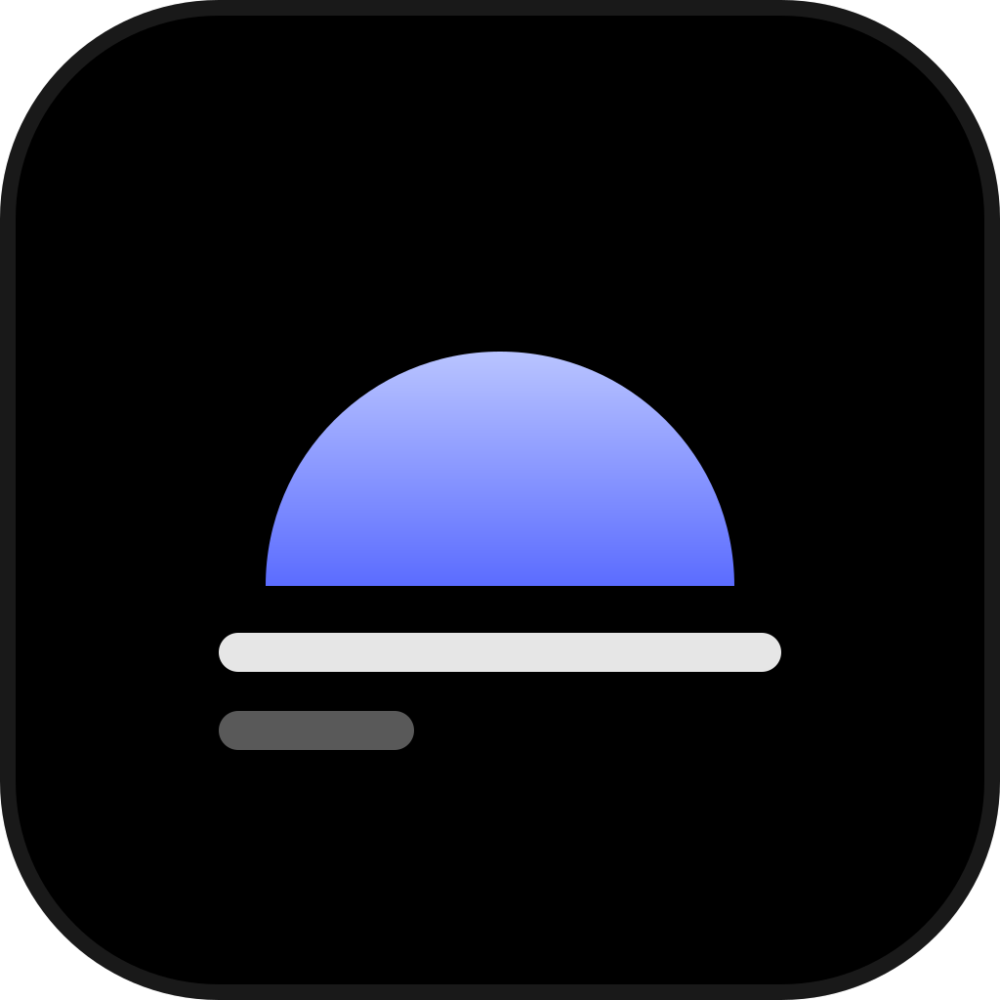
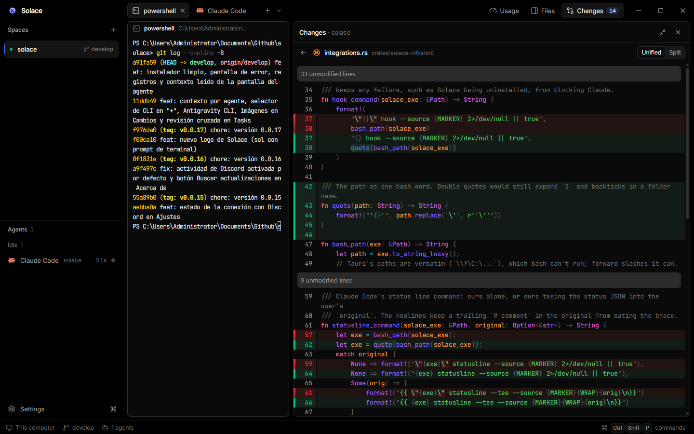

<p align="center">
  
</p>

<h1 align="center">Solace</h1>

<p align="center">
  A desktop terminal to run and orchestrate AI coding agents.<br>
  Windows, macOS (Apple Silicon) and Linux.
</p>



Solace groups your terminals by project, knows what each agent is doing, and lets one agent hand work to others in parallel, each in its own git branch.

Works with Claude Code, Codex, Antigravity CLI, OpenCode, Qwen Code, Kimi Code, Copilot, Cursor Agent and Amp.

## Features

- **Spaces, tabs and splits**: one space per project folder, with tabs and resizable split panes (mouse or **Alt+Shift+arrows**). Pick PowerShell, cmd, Git Bash or WSL as the shell.
- **Agent awareness**: every agent in any pane (also inside WSL) shows its state: working, needs you, or done. You get a notification when one needs you or finishes.
- **Any CLI in one click**: the **+** menu opens a tab with any agent CLI installed on your machine.
- **Solace Tasks**: a lead agent runs `solace tasks start` and fans N tasks out to N agents in parallel. Each works in its own git worktree and branch. A review round then has agents review each other's branches. Nothing is merged until you say so.
- **`solace` CLI**: agents open panes, start other agents, prompt them and read their screens. `solace skill install` teaches Claude Code how.
- **Usage meter**: Claude 5-hour and weekly limits (read from the Claude Code status line), Codex limits and token counts, plus a context ring per agent.
- **Files panel**: lazy file tree with an in-app viewer for Markdown, code and images.
- **Changes panel**: git status with syntax-highlighted diffs and before/after for images.
- **Personalization**: light and dark themes, accent color, fonts, custom CSS and a theme editor.
- **Discord Rich Presence**: shows which agent you are using, never folders or file names. Optional.
- **Auto-updates**: downloaded in the background, applied when you restart.

## Install

Download the installer for your system from [GitHub Releases](https://github.com/angeldqr/solace/releases):

| System                    | File                  |
| ------------------------- | --------------------- |
| Windows 10/11             | `.exe` or `.msi`      |
| macOS 11+ (Apple Silicon) | `.dmg`                |
| Linux (x86_64)            | `.AppImage` or `.deb` |

> [!NOTE]
> The macOS app is not notarized (only ad-hoc signed), so macOS blocks it the first time. Right-click it and choose **Open**, or run `xattr -dr com.apple.quarantine /Applications/Solace.app`.

> [!NOTE]
> On Linux only the AppImage updates itself; install a new `.deb` by hand. Windows releases are unsigned until SignPath approval ([details](docs/code-signing.md)).

## Solace Tasks

Inside a Solace terminal, ask your agent to split work, or run it yourself:

```sh
solace tasks start <<'EOF'
[
  {"title": "Fix login redirect", "prompt": "In src/auth/login.ts the redirect ignores ?next=. Fix it and add a test."},
  {"title": "Dark mode contrast", "prompt": "Sidebar text fails WCAG AA. Adjust the tokens in src/theme.css.", "kind": "codex"}
]
EOF
solace tasks wait
```

Each task gets a pane, a worktree under `.solace/` and a branch. The full agent guide is in [skills/solace/SKILL.md](skills/solace/SKILL.md).

## Build from source

Requirements: Rust (stable, pinned in `rust-toolchain.toml`; MSVC on Windows), Node 24+, pnpm 10 and the [Tauri prerequisites](https://tauri.app/start/prerequisites/).

```sh
pnpm install
pnpm tauri dev      # run the app
pnpm tauri build    # build installers
pnpm test           # frontend tests
cargo test --workspace
pnpm lint
```

The code is split into `crates/solace-core` (domain), `crates/solace-infra`, `crates/solace-cli` (the `solace` command), `src-tauri` (desktop shell) and `src` (React UI).

## Privacy

Solace has no telemetry. Its only own network requests are update checks and downloads from GitHub Releases (can be turned off in **Settings > About**). Discord Rich Presence talks to Discord only while Discord is open. Agents you run follow their own privacy policies.

Licensed under [Apache-2.0](LICENSE).
